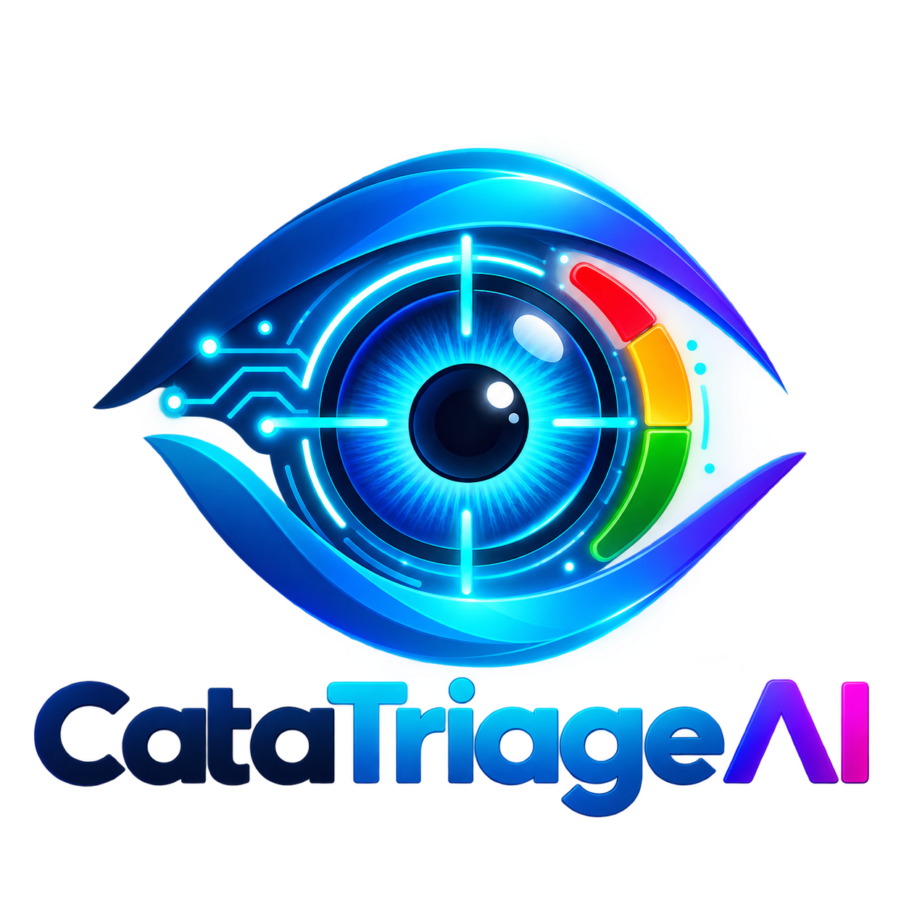
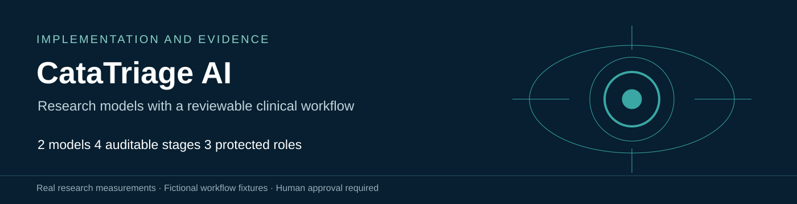
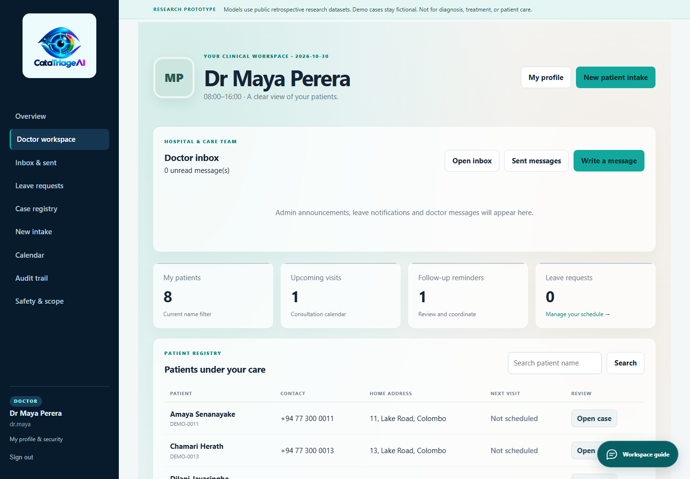
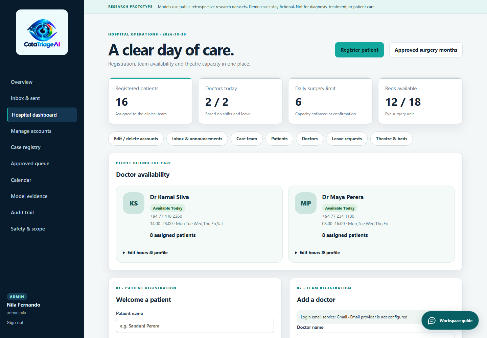
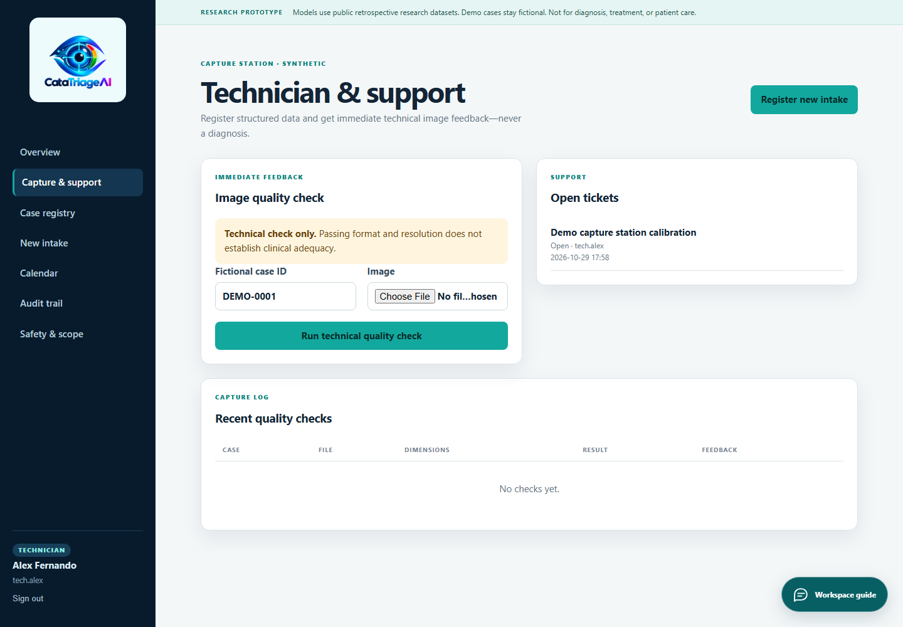
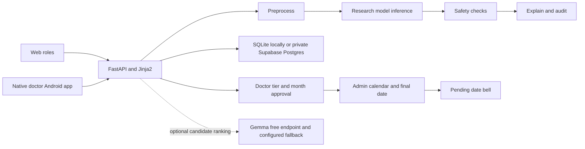

<div align="center">


# CataTriage AI

**Cataract research models and a doctor reviewed hospital workflow**

[Live website](https://catatriage-ai.vercel.app) · [Implementation report](docs/submission/Technical_Report.pdf) · [Two page summary](docs/submission/Two_Page_Summary.pdf) · [Android APK](output/android/CataTriage-Doctor-1.1.0.apk)


</div>



CataTriage AI combines two models trained on real retrospective research data with patient intake, per-eye image review, four auditable processing stages and a two-step surgery scheduling workflow. Doctors enter the clinical tier and approve a planning month. Hospital admins choose a free date inside that month. A native Android app serves doctors.

> **Research and competition use.** The app is not clinically validated. Demo patient records and screenshots are fictional. The model data and recorded test results are real research artifacts. Model confidence never sets urgency or a safe waiting period.

## Start here

| For | Open |
| --- | --- |
| Judges | [Two page summary PDF](docs/submission/Two_Page_Summary.pdf) · [editable Word](docs/submission/Two_Page_Summary.docx) |
| Technical review | [Implementation report PDF](docs/submission/Technical_Report.pdf) · [editable Word](docs/submission/Technical_Report.docx) |
| Model evidence | [Current evidence PDF](output/pdf/real_models_and_agents_evidence.pdf) · [editable Word](output/pdf/real_models_and_agents_evidence.docx) |
| Run locally | [Quick start below](#run-locally) · [reproduction notes](docs/competition/REPRODUCIBILITY.md) |
| Data and limitations | [Data provenance](docs/competition/DATA_PROVENANCE.md) · [model card](docs/competition/MODEL_CARD.md) |
| Proposal comparison | [Delivered and partial requirements](docs/competition/PROPOSAL_COMPARISON.md) |
| Android | [APK download](output/android/CataTriage-Doctor-1.1.0.apk) · [native source and build notes](android/README.md) |

## What is implemented

- **Doctor workspace:** assigned patients, clinical notes, original left/right/unknown-side uploads, model results, reports, Inbox/Sent, leave, calendar and profile/password management.
- **Hospital admin:** account and patient management, approved queue, capacity, leave, audit history, month-to-date scheduling and optional AI slot explanations.
- **Technician/support:** structured registration, original image capture/upload and immediate technical quality feedback.
- **Persistent red bell:** counts doctor-approved months awaiting an exact date; reading it does not clear it. Doctors see their own assigned cases.
- **Workspace guide:** role-specific navigation chat, quick actions, four-agent help, current model metrics and a capture checklist. This guide is built-in, not an external LLM.
- **Android doctor app:** native Java UI, camera/gallery, API inference, doctor review, month approval, messages and PDF export. Inference runs on the server; there is no offline model.

<details>
<summary><strong>See the interface</strong></summary>

All records in these images are isolated fictional fixtures.





</details>

## Architecture



The web app uses Python, FastAPI, Jinja2 and local CSS/JavaScript. PyTorch and NumPy run inference on CPU or CUDA. GPU CatBoost trees are exported as numeric arrays, so the hosted app needs no CatBoost library. Local storage uses three SQLite files; cloud storage uses three private Supabase schemas, not three separate hosted database servers. Vercel hosts the Python app. Firebase supports the optional doctor email setup flow.

## Measured model results

The 30 October 2026 tuning run used an RTX 2050. Candidates and blend weights were selected with training/validation data. The original historical test sets were then reused once for final comparison; they are not fresh external validation.

| Current research model | Train accuracy | Validation accuracy | Test accuracy | Previous test | Test macro F1 |
| --- | ---: | ---: | ---: | ---: | ---: |
| Multi-data grading v2 | 70.79% | 54.36% | **56.04%** | 53.69% | 56.67% |
| Image-context fusion v2 | 72.14% | 65.00% | **55.00%** | 52.50% | 47.93% |

Grading uses 1,986 participants from one Taizhou clinical cohort, with a 1,390/298/298 split. Its four-level target is a derived maximum of recorded bilateral grades. The 44 raw inputs exclude direct cataract labels and grading fields. The tuned predictor blends a GPU-trained CatBoost ensemble (75%) with the prior neural model (25%).

Fusion uses only the **200-image CatScreen public clean sample**, with 140/20/40 images and no participant overlap across splits. It blends MobileNetV3-Small (75%) and a ResNet-18 context CNN (25%). Context means eye side and acquisition/quality metadata, not a verified full clinical history. Normal recall remains **2/8**, cataract recall **15/27**, and other-class recall **5/5**. The small gains do not establish statistical superiority.

Approximate test accuracy intervals are 50.7–61.7% for grading and 37.5–71.4% for fusion. A trial with 99% training accuracy was rejected for validation overfitting. Previous fusion training accuracy used random augmentation, so its old training score is not directly comparable to the new deterministic evaluation. See [model cards and limits](docs/competition/MODEL_CARD.md).

The older EfficientNet-B0 fundus classifier remains a separate baseline: 72.53% accuracy on 91 image-level test examples. It is neither a slit-lamp severity model nor an urgency model. Synthetic simulation scores are pipeline checks, not real-data clinical evidence.

## Run locally

Use Python 3.12 on Windows or Linux, a virtual environment and a few GB of free disk for PyTorch. GPU access and provider keys are **not needed to run the demo**. The first dependency installation needs internet.

```bash
git clone https://github.com/CodeJediX/CataTriage-AI.git
cd CataTriage-AI
python -m venv .venv
# Windows PowerShell: .venv\Scripts\Activate.ps1
# Linux: source .venv/bin/activate
python -m pip install -r requirements.txt
python -m uvicorn deployment.demo_app.main:app --host 127.0.0.1 --port 8000
```

Open **http://127.0.0.1:8000/login**. Without cloud configuration, the app creates local fictional fixtures and private local storage. If using the competition ZIP, enter its `code` folder instead of cloning.

| Local demo role | Username | Local demo password |
| --- | --- | --- |
| Doctor | `dr.maya` | `demo-doctor` |
| Hospital admin | `admin.nila` | `demo-admin` |
| Technician/support | `tech.alex` | `demo-tech` |

These are public **local fixture credentials**, not the hosted website passwords. Hosted access requires an authorized account; no production password is distributed.

### Verify the clean package

```bash
python tools/judge_smoke.py
python -m pip install -r requirements-dev.txt
python -m pytest tests -q
```

The full workspace run passed 110 backend tests. A source-only checkout skips one optional raw-image smoke test when its source image is absent; it still tests the packaged checkpoints and workflow. Browser tests also covered mobile layout, navigation chat and persistent scheduling alerts. These are recorded verification results, not a claim of clinical validation or a GitHub Actions run.

## Five minute judging walkthrough

1. Start locally and sign in as the doctor. Open a fictional case and inspect the separate image fields and four-agent trace. A valid original image is needed for new image inference; no patient images are bundled.
2. Enter a tier and reason. Record functional impact and progression, request a month suggestion and approve an appropriate month.
3. Sign in as admin. Open the red bell, view the approved month and choose a free date after checking the calendar. Confirm the booking and observe the bell count update.
4. Open Model evidence to inspect the current results, uncertainty, confusion matrices and rejected overfitting run.
5. Try the workspace guide with “open calendar” and “show model accuracy”. Optionally install the doctor APK and use a separately authorized hosted doctor account.

## Configuration and optional integrations

The base app runs without Supabase, Firebase or an LLM key. For cloud mode use server-only environment variables listed in [configuration notes](docs/competition/CONFIGURATION.md). Apply the private SQL schemas before starting cloud mode. Do not commit `.env`, local databases, uploads or signing keys.

Gemma and the configured free NVIDIA fallback can rank constrained scheduling candidates. Provider outages fall back to clearly labelled local availability rules. The assistant never approves a clinical tier or booking. Automatic WhatsApp requires a verified Business sender and template; the manual handoff and delivery status remain available. No payment or production clinical-readiness claim is implied by the free demo hosting.

## Repository map

```text
deployment/demo_app/   FastAPI routes, services, templates and local assets
deployment/cloud/     Private Postgres schemas and Vercel configuration
agents/               Four deterministic processing stages
models/               Active checkpoints, baseline references and metrics
android/              Native doctor application source
tests/                Backend regression tests and isolated fixtures
tools/                Training, tuning, evidence and verification utilities
docs/competition/     Setup, architecture, data and proposal comparison
docs/submission/      Technical report and exact two-page summary in PDF and Word
output/pdf/           Current evidence and historical reports with Word counterparts
output/android/       Signed release APK and checksum metadata
data_splits/          Frozen fundus split manifests; original images are excluded
```

## Data rights and research boundaries

Raw training collections, live patient records, cloud secrets and Android signing material are excluded. Dataset and pretrained-weight terms remain with their providers; this repository does not grant rights to those collections. CatScreen is research/education-only and its full release requires institutional approval. The source is supplied for competition review; no broader software or dataset license is asserted here. See [third-party notices](docs/competition/THIRD_PARTY_NOTICES.md).

The main gaps are verified paired clinical/image data, external and chronological validation, calibration, subgroup evaluation and reliable severity/urgency labels. The software demonstrates a reviewable implementation; it is not a medical device. Historical readiness/synthetic PDFs are retained only for archived app links and are explicitly superseded by the current v2 evidence.
